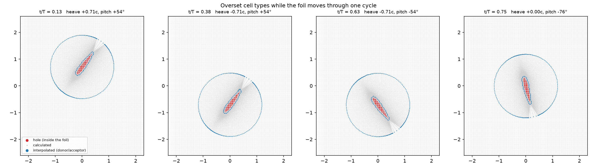
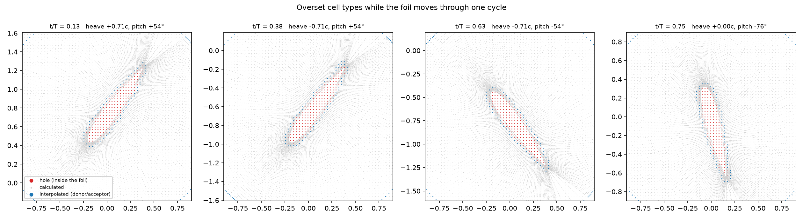

# AE-471 CFD course project: overset reproduction of Kinsey & Dumas (2008)

**Team:** Zain Ul Abideen (466576), Ahmed Mukhtar Bukhari (461298). **Pathway B, research paper reproduction.**

We reproduce the power-extraction efficiency of an oscillating NACA 0015 airfoil from
T. Kinsey and G. Dumas, "Parametric Study of an Oscillating Airfoil in a Power-Extraction Regime", *AIAA Journal* 46(6), 1318–1330, 2008, doi:10.2514/1.26253.
Case I: Re = 1100, f\* = fc/U = 0.14, heave amplitude H₀ = c, pitch amplitude θ₀ = 76.33°, pivot at c/3, heave leading pitch by 90°. Published efficiency **η = 33.7 %**; our independent WaterLily (immersed-boundary) result from the FYP is 32.2 %.

Everything runs on **GitHub Actions** with **OpenFOAM (ESI, v2412)** and **gmsh**, using an **overset mesh**: a body-fitted O-grid that moves with the foil, laid over a fixed Cartesian background.

## How the mesh is built

| Part | Tool | Details |
|---|---|---|
| O-grid around the foil | gmsh (Python API) → `gmshToFoam` | Structured, 3 blocks (upper, lower, blunt trailing edge), radius 1.2c around the pivot, first cell 0.002c (medium), one cell thick |
| Background | `blockMesh` (generated) | 24 × 36 chords; uniform fine box x ∈ [−2, 6], y ∈ [−2.8, 2.8] covering every foil position; graded outside (growth 1.1) |
| Joining | `mergeMeshes`, `topoSet`, `setFields` | `zoneID` 0 = background, 1 = O-grid; the O-grid is the cellZone `movingZone` |
| Motion | `tabulated6DoFMotion` | Table from `scripts/make_mesh_inputs.py`: heave h = H₀cos(2πf t), pitch θ = θ₀sin(2πf t) about the pivot, zero at t = 0 |
| Solver | `overPimpleDyMFoam`, laminar, ν = 1/1100 | Inlet U = 1, outlet p = 0, slip top/bottom, moving wall on the foil |

Three mesh levels (background cell 0.045 / 0.030 / 0.020 c, refinement ratio 1.5) are defined in [`scripts/params.py`](scripts/params.py).

## Plan

| Phase | What | Status |
|---|---|---|
| 0 | Install OpenFOAM + gmsh on a runner, run an official overset tutorial | ✅ done |
| 1 | Build the three meshes, `checkMesh`, move the mesh through one cycle, check hole cutting | ✅ done |
| 2 | Case I, medium mesh, 2 cycles: sensible forces, time per cycle (two hole-cutting methods compared) | running |
| 3 | Case I baseline, 10 cycles, average the last 6 | |
| 4 | Verification: 3 meshes, 2 time steps, domain check | |
| 5 | Trend cases: Case II and other pitch amplitudes | |
| 6 | Post-processing and report | |

## Phase 0 result: the tools work on GitHub

OpenFOAM v2412 (ESI) and gmsh 4.15 install on a standard runner (4 cores, 16 GB) in a few minutes, and the official overset tutorial (`overPimpleDyMFoam/cylinder`) runs to the end. Details: [`docs/phase0_versions.txt`](docs/phase0_versions.txt), [`docs/phase0_tutorial.txt`](docs/phase0_tutorial.txt).

## Phase 1 result: the overset mesh is valid at all three levels

| Level | Background cells | O-grid cells | Total | First wall cell | checkMesh | Max non-orthogonality | Holes / interpolated cells during the cycle |
|---|---|---|---|---|---|---|---|
| coarse | 47,600 | 7,560 | 55,160 | 0.0030 c | Mesh OK | 61° | ≈ 90 / 185 |
| medium | 90,514 | 17,091 | 107,605 | 0.0020 c | Mesh OK | 62° | ≈ 180 / 280 |
| fine | 177,072 | 38,918 | 215,990 | 0.0013 c | Mesh OK | 62° | ≈ 350 / 420 |

The O-grid (medium) around the leading edge and the blunt trailing edge:


The O-grid laid over the background at t = 0 (foil at the top of its stroke):


The mesh was then moved through one full flapping cycle (`moveDynamicMesh`, 200 steps) and the overset cell types were recorded. Only the background cells inside the foil become holes (red); a ring of interpolated cells (blue) forms around the hole and at the O-grid edge, at every position of the stroke:




**Problem found and fixed on the way:** in the first run the hole cutting flooded the whole background. gmsh had left the O-grid's front and back faces as an ordinary `patch`, so `mergeMeshes` kept them separate and the overset algorithm treated them like walls. The O-grid front/back are now set to `empty` before merging, and the workflow fails automatically if holes ever exceed 5 % of the cells.

**Watch for Phase 2:** moving the mesh alone took about 2.5 s per step on the medium mesh (`moveDynamicMesh` also re-checks the mesh every step). If the flow solver is similarly slow, a 10-cycle run at T/2000 would not fit in a 6-hour job; options are the faster `trackingInverseDistance` hole cutting, a larger time step, and splitting runs into restartable segments. Phase 2 will measure the real cost.

Per-level numbers: [`docs/phase1/`](docs/phase1).

## Where the results are

Each workflow commits its logs, tables and pictures to the **`ci-results`** branch (`phase0/`, `phase1/<level>/`), so they can be read without opening the Actions page. Run locally (Linux with OpenFOAM v2412 and `pip install gmsh`):

```
bash scripts/build_mesh.sh medium run/medium out/medium
bash scripts/motion_test.sh run/medium/main out/medium 200
```
