# AE-471 CFD course project: OpenFOAM reproduction of Kinsey & Dumas (2008)

**Team:** Zain Ul Abideen (466576), Ahmed Mukhtar Bukhari (461298). **Pathway B, research paper reproduction.**

We reproduce the power-extraction efficiency of an oscillating NACA 0015 airfoil from
T. Kinsey and G. Dumas, "Parametric Study of an Oscillating Airfoil in a Power-Extraction Regime", *AIAA Journal* 46(6), 1318–1330, 2008, doi:10.2514/1.26253.
Case I: Re = 1100, f\* = fc/U = 0.14, heave amplitude H₀ = c, pitch amplitude θ₀ = 76.33°, pivot at c/3, heave leading pitch by 90°. Published efficiency **η = 33.7 %**; our independent WaterLily (immersed-boundary) result from the FYP is 32.2 %.

Everything runs on **GitHub Actions** with **OpenFOAM (ESI, v2412)** and **gmsh**. Two moving-mesh methods were built and tested:

- **Overset:** a body-fitted O-grid moving over a fixed background (Phases 0–1). It works, but flow runs proved far too expensive or unstable on free runners (see Phase 2).
- **Rigid moving mesh (used for the results):** the same O-grid plus a polar ring to a round far field (20c at first, 80c after the Phase 4 domain study). The whole mesh heaves and pitches with the foil. This is equivalent to Kinsey & Dumas' own method (a heaving reference frame with a rigidly pitching zone), and it runs about 2,000 times faster than overset here.

## How the mesh is built

| Part | Tool | Details |
|---|---|---|
| O-grid around the foil | gmsh (Python API) → `gmshToFoam` | Structured, 3 blocks (upper, lower, blunt trailing edge), radius 1.2c around the pivot, first cell 0.002c (medium), one cell thick |
| Background | `blockMesh` (generated) | 24 × 36 chords; uniform fine box x ∈ [−2, 6], y ∈ [−2.8, 2.8] covering every foil position; graded outside (growth 1.1) |
| Joining | `mergeMeshes`, `topoSet`, `setFields` | `zoneID` 0 = background, 1 = O-grid; the O-grid is the cellZone `movingZone` |
| Motion | `tabulated6DoFMotion` | Table from `scripts/make_mesh_inputs.py`: heave h = H₀cos(2πf t), pitch θ = θ₀sin(2πf t) about the pivot, zero at t = 0 |
| Solver | `overPimpleDyMFoam`, laminar, ν = 1/1100 | Inlet U = 1, outlet p = 0, slip top/bottom, moving wall on the foil |

Three mesh levels (background cell 0.045 / 0.030 / 0.020 c, refinement ratio 1.5) are defined in [`scripts/params.py`](scripts/params.py).

## Plan

| Phase | What | Status |
|---|---|---|
| 0 | Install OpenFOAM + gmsh on a runner, run an official overset tutorial | ✅ done |
| 1 | Build the three meshes, `checkMesh`, move the mesh through one cycle, check hole cutting | ✅ done |
| 2 | Case I, medium mesh: sensible forces, time per cycle; choose the moving-mesh method | ✅ done (rigid moving mesh chosen) |
| 3 | Case I baseline, 10 cycles, average the last 6 | ✅ done: η = 34.66 % at 20c |
| 4 | Verification: 3 meshes, 3 time steps, 5 domain sizes, solver settings | ✅ done: η = 32.95 + 34.1/R; mesh ±0.5 points |
| 5 | Trend cases: Kinsey & Dumas Cases I, II and III (Table 2), medium + fine, far field 80c | ✅ done: all three within 0.5 points of the paper |
| 6 | Post-processing, animations and report | ✅ done: [Word report](report/AE471_Project_Report.docx) ([PDF preview](report/AE471_Project_Report.pdf)), vorticity animations of all three cases |

## Phase 0 result: the tools work on GitHub

OpenFOAM v2412 (ESI) and gmsh 4.15 install on a standard runner (4 cores, 16 GB) in a few minutes, and the official overset tutorial (`overPimpleDyMFoam/cylinder`) runs to the end. Details: [`docs/phase0_versions.txt`](docs/phase0_versions.txt), [`docs/phase0_tutorial.txt`](docs/phase0_tutorial.txt).

## Phase 1 result: the overset mesh is valid at all three levels

| Level | Background cells | O-grid cells | Total | First wall cell | checkMesh | Max non-orthogonality | Holes / interpolated cells during the cycle |
|---|---|---|---|---|---|---|---|
| coarse | 47,600 | 7,560 | 55,160 | 0.0030 c | Mesh OK | 61° | ≈ 90 / 185 |
| medium | 90,514 | 17,091 | 107,605 | 0.0020 c | Mesh OK | 62° | ≈ 180 / 280 |
| fine | 177,072 | 38,918 | 215,990 | 0.0013 c | Mesh OK | 62° | ≈ 350 / 420 |

The O-grid (medium) around the leading edge and the blunt trailing edge:

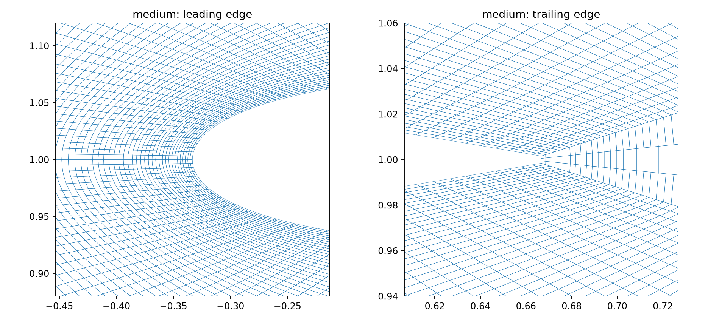

The O-grid laid over the background at t = 0 (foil at the top of its stroke):

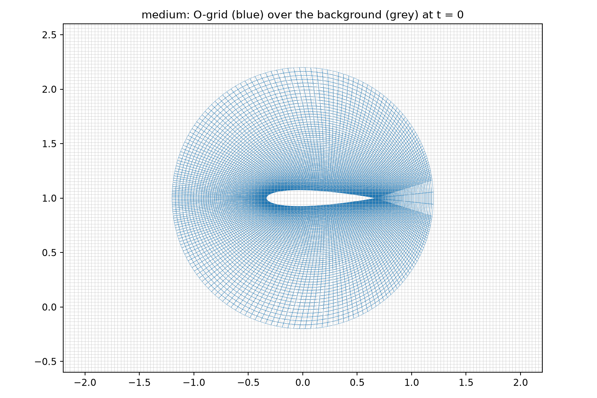

The mesh was then moved through one full flapping cycle (`moveDynamicMesh`, 200 steps) and the overset cell types were recorded. Only the background cells inside the foil become holes (red); a ring of interpolated cells (blue) forms around the hole and at the O-grid edge, at every position of the stroke:


**Problem found and fixed on the way:** in the first run the hole cutting flooded the whole background. gmsh had left the O-grid's front and back faces as an ordinary `patch`, so `mergeMeshes` kept them separate and the overset algorithm treated them like walls. The O-grid front/back are now set to `empty` before merging, and the workflow fails automatically if holes ever exceed 5 % of the cells.

**Watch for Phase 2:** moving the mesh alone took about 2.5 s per step on the medium mesh (`moveDynamicMesh` also re-checks the mesh every step). If the flow solver is similarly slow, a 10-cycle run at T/2000 would not fit in a 6-hour job; options are the faster `trackingInverseDistance` hole cutting, a larger time step, and splitting runs into restartable segments. Phase 2 will measure the real cost.

Per-level numbers: [`docs/phase1/`](docs/phase1).

## Phase 2 result: overset is too costly, the rigid moving mesh reproduces the paper

**Overset flow runs (medium mesh, 108k cells, 4 cores):**

| Set-up | Cost | Outcome |
|---|---|---|
| Courant number held ≤ 1, standard hole cutting | 21 s per step; the time step fell to T/52,000 | ≈ 290 h per cycle |
| Courant number held ≤ 1, tracking hole cutting | 14 s per step; time step T/50,000 | ≈ 200 h per cycle |
| Fixed T/2000 step (as Kinsey & Dumas), tracking hole cutting | 8 s per step | diverged within the first cycle |

The overset run would need weeks of runner time for one case, so it cannot support a mesh and time-step study.

**Kinsey & Dumas' own method** (from the paper, section II.C) avoids remeshing and overlapping grids. They solved in a frame that heaves with the foil and rotated a circular inner zone rigidly with it, with a fixed step of T/2000 and 72,000 cells. The OpenFOAM equivalent is to move the **whole** mesh rigidly with the foil's heave and pitch (`solidBody` motion, `tabulated6DoFMotion`, `pimpleFoam`), with freestream conditions on a round far-field boundary.

**Rigid moving mesh, medium (28,907 cells: the Phase 1 O-grid plus a polar ring to 20c), fixed T/2000, 3 cycles:** **0.16 s per step, 5.5 minutes per cycle** (16 minutes for the whole run).

| | η % | mean C_X | peak C_Y | peak C_M | lift timing |
|---|---|---|---|---|---|
| cycle 1 (start-up) | 42.3 | 2.506 | 2.944 | 0.912 | −8° |
| cycle 2 | 35.6 | 2.120 | 1.956 | 0.670 | +1° |
| **cycle 3** | **35.0** | **2.092** | **1.915** | **0.645** | **+2°** |
| Kinsey & Dumas (2008) | 33.7 | 2.014 | 1.910 | 0.646 | ≈ 0° |
| WaterLily (FYP, 64 cells/chord) | 32.2 | 2.11 | 1.98 | 0.67 | within 3° |

After three cycles the forces are within 0.3 % (lift) and 0.2 % (moment) of the paper, and drag and efficiency are within 4 %; efficiency is still settling from cycle to cycle, which Phase 3 (10 cycles) will settle.

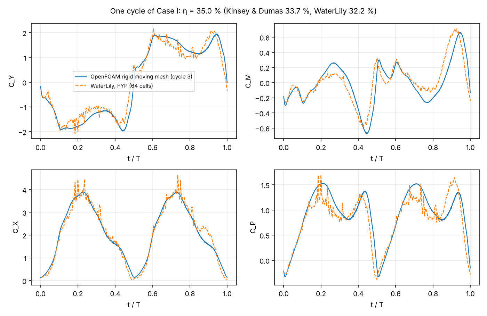

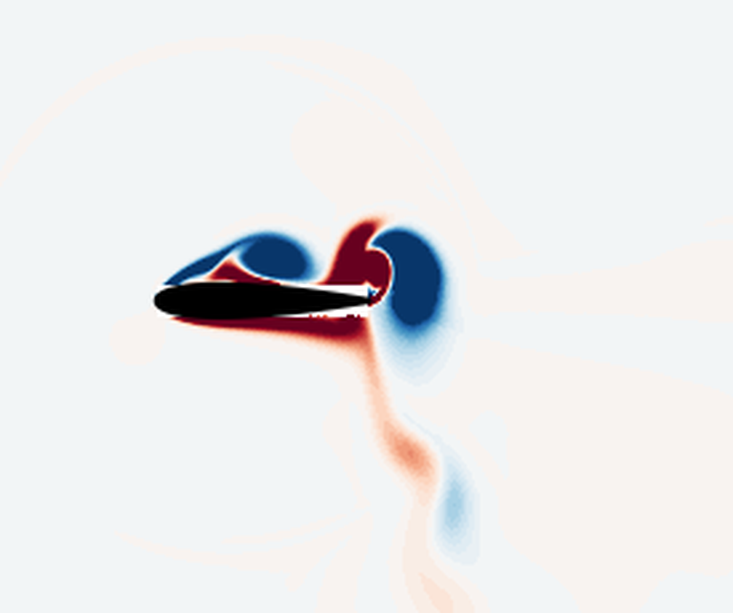

The rigid mesh near the foil (same O-grid as Phase 1, then the polar ring):

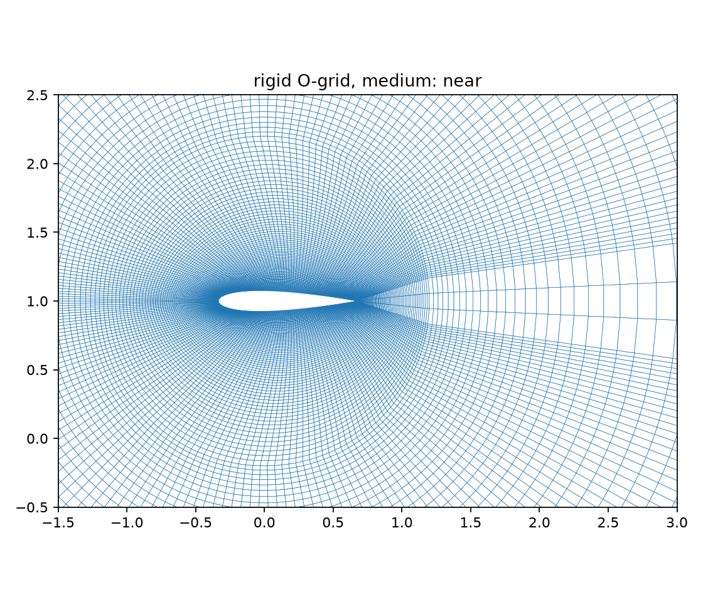

Problems fixed on the way: a first rigid mesh made of one block from the foil to 20c had a very thin trailing-edge sector (844 faces above 70° non-orthogonality) and diverged in ~70 steps; reusing the Phase 1 O-grid as the inner ring fixed it (max 61.5°).

> **27 Nov 2026 correction.** All numbers below use bin-averaged cycle statistics (`scripts/cycle_stats.py`). The motion table (400 points per cycle) gives the forces a small step every 5 time steps, and the first post-processing sampled exactly at those steps; it raised every efficiency by 0.1–0.3 points (Case II: 11.23 % instead of 10.90 %). Every run was reprocessed from its saved force history with `scripts/reprocess_cycles.py`; no conclusion changed.

## Phase 3 result: the Case I baseline settles to η = 34.66 %

Medium mesh (28,907 cells), fixed step T/2000 (as Kinsey & Dumas), far field at 20c, 10 cycles (52 minutes on 4 cores). After four start-up cycles every cycle gives the same answer to 0.05 points, so cycles 5–10 are averaged.

| | η % | mean C_X | peak C_Y | peak C_M | lift timing |
|---|---|---|---|---|---|
| cycle 1 (start-up) | 41.87 | 2.506 | 3.166 | 0.909 | −10° |
| cycle 4 | 34.75 | 2.082 | 1.888 | 0.635 | +2° |
| cycle 10 | 34.66 | 2.077 | 1.878 | 0.629 | +2° |
| **average of cycles 5–10** | **34.66 ± 0.03** | **2.077** | **1.880** | **0.630** | **+2°** |
| Kinsey & Dumas (2008) | 33.7 | 2.014 | 1.910 | 0.646 | ≈ 0° |
| WaterLily (FYP) | 32.2 | 2.11 | 1.98 | 0.67 | within 3° |

Peak lift and moment are within 2–3 % of the paper; drag and efficiency are about 3 % high. Phase 4 shows that almost all of that 3 % comes from the far field being only 20 chords away.

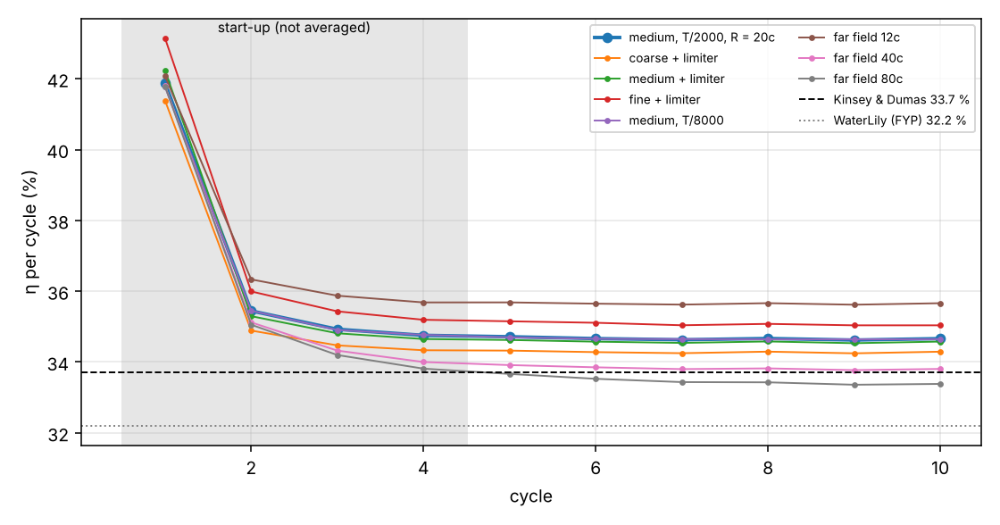

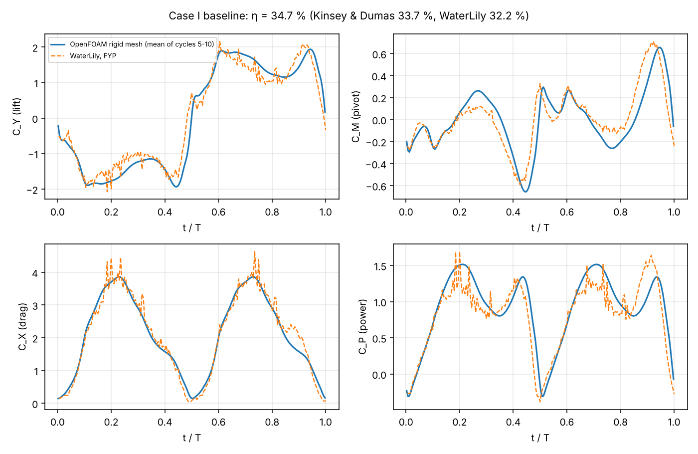

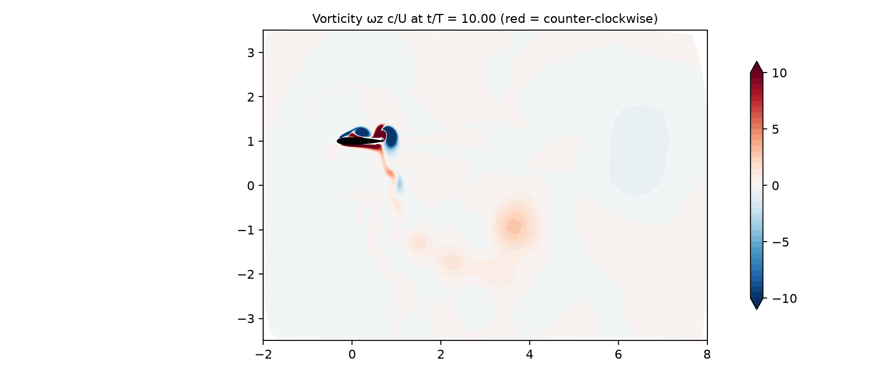

## Phase 4 result: what changes the answer and what does not

Each check changes one setting of the baseline. 22 runs in all; every table is in [`docs/phase3_4/phase34_summary.md`](docs/phase3_4/phase34_summary.md).

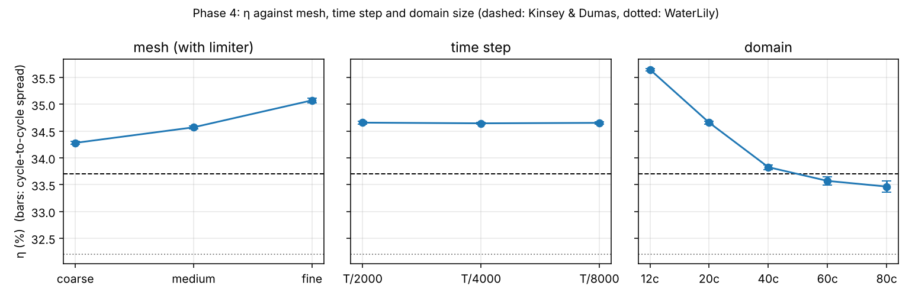

**Time step: no effect.** T/2000, T/4000 and T/8000 give 34.66, 34.65 and 34.65 %. T/1000 blows up in the first cycle (Courant number about 26 at the trailing edge), so T/2000, the paper's step, is the right choice.

**Domain size: the biggest effect.** Moving the round far field from 12c to 80c lowers η by 2.3 points. The results from 20c to 80c fall exactly on a straight line in 1/R (the slow 1/R decay of a lifting body's far field), so the infinite-domain value can be read off:

| Far field | 12c | 20c | 40c | 60c | 80c | ∞ (fit) |
|---|---|---|---|---|---|---|
| η at cycle 10 (%) | 35.66 | 34.66 | 33.81 | 33.52 | 33.38 | **32.95** |

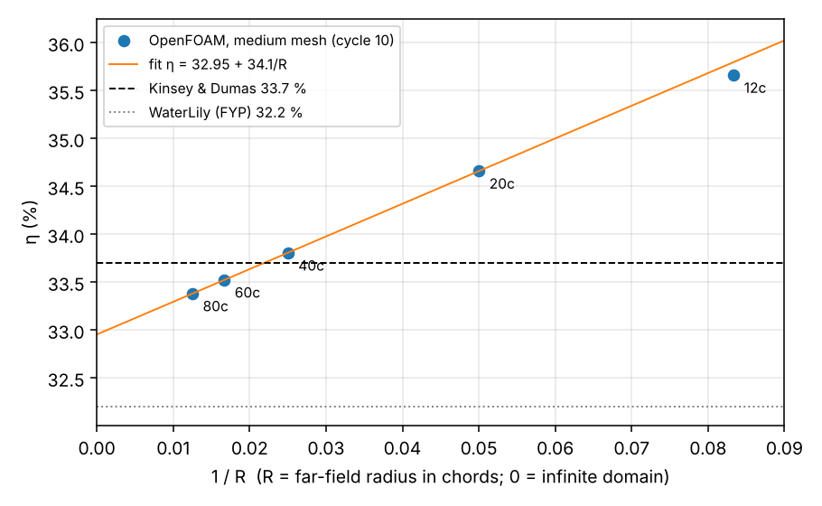

η = 32.95 + 34.1/R. At 80c the domain error is 0.43 points, so Phase 5 uses 80c.

**Mesh: about ±0.5 points.** The fine mesh first blew up after ~80 steps whatever the time step, even with the foil standing still. A diagnostic run that wrote every step found the blow-up starting in the first cells behind the blunt trailing edge, which are strongly sheared on the fine mesh. The standard OpenFOAM cure, limiting the non-orthogonal correction (`limited corrected 0.33`), fixed it, so all three meshes were rerun with that setting:

| Mesh (with the limiter, 20c) | Cells | η % | mean C_X | peak C_Y | peak C_M | Time per cycle |
|---|---|---|---|---|---|---|
| coarse | 14,560 | 34.28 | 2.096 | 1.904 | 0.579 | 1.4 min |
| medium | 28,907 | 34.57 | 2.086 | 1.891 | 0.592 | 3.5 min |
| fine | 58,696 | 35.07 | 2.096 | 1.918 | 0.581 | 12 min |
| extra-fine | 120,960 | blew up even with the limiter | | | | |

The change from medium to fine (+0.5) is larger than from coarse to medium (+0.3), so the mesh is not yet converged and a grid convergence index cannot be computed. We take ±0.5 points as the mesh uncertainty. The extra-fine mesh still blew up after changing the trailing-edge block (cells across the edge, block angle, point clustering, smoothing) and after a potential-flow start (`te-tests.yml`); a more fundamental redesign of the trailing-edge mesh is the main improvement for future work. The paper saw the same direction (33.6 → 33.7 → 33.9 % from 16k to 253k cells).

**Solver settings: small.** Four outer loops per step, a velocity-gradient limiter and the laplacian limiter all stay within 0.1 points of the baseline η. The laplacian limiter lowers the peak moment by about 6 % (0.630 → 0.592), so peak C_M carries that extra uncertainty.

## Phase 5 result: all three Kinsey & Dumas cases within 0.5 points

The three cases of Kinsey & Dumas' Table 2 were run with the settings Phase 4 chose: rigid moving O-grid, laplacian limiter, T/2000 (T/4000 for the slow Case III, to keep the Courant number like Case I), far field 80c, on the medium (33k cells at 80c) and fine (65k) meshes. Averages use the settled cycles: Case I 9–14, Case II 9–16, Case III 5–8 (cycle-to-cycle spread ≤ 0.06 points).

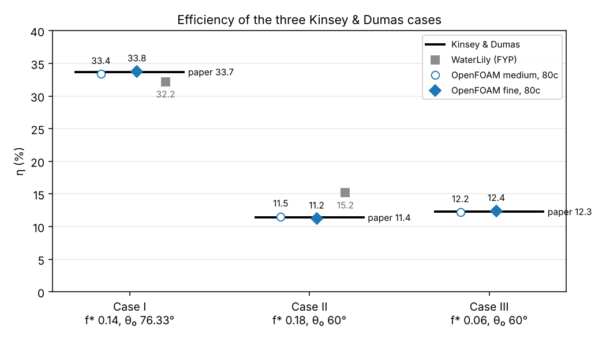

| Case | f*, θ₀ | OpenFOAM medium | OpenFOAM fine | Kinsey & Dumas | WaterLily (FYP) |
|---|---|---|---|---|---|
| I | 0.14, 76.33° | 33.28 % | 33.67 % | 33.7 % | 32.2 % |
| II | 0.18, 60° | 11.20 % | 10.90 % | 11.4 % | 15.2 % |
| III | 0.06, 60° | 12.20 % | 12.38 % | 12.3 % | not run |

- **Efficiency:** every OpenFOAM value is within 0.5 points of the paper. For Cases I and III the paper's value lies between our medium and fine results; for Case II both are slightly low. Corrected for the remaining 80c domain error (Case I slope 34.1/R = 0.43 points), Case I becomes 32.85 % (medium) and 33.24 % (fine).
- **Forces:** mean drag and peak lift are within 1–4 % of the paper in every case. Peak moment agrees for Cases II and III (within 0–5 %) but is 14–17 % low for Case I (0.54–0.56 against 0.646). Part of that is the non-orthogonal limiter (−6 % in Phase 4) and part the larger domain (0.630 at 20c → 0.595 at 80c); Case I's peak moment is the least certain number here.
- **Where the power comes from (fine mesh):** Case I takes 0.835 from heave and +0.028 from pitch; Case II loses −0.130 through pitch (lift lags the heave velocity by 55°); Case III gets almost all of its power from heave.
- **WaterLily's Case II gap is in WaterLily.** OpenFOAM reproduces the paper's 11.4 % to within 0.5 points, so WaterLily's 15.2 % is a WaterLily problem, not the case. The averaged cycle shows where: near each stroke reversal (t/T ≈ 0.4 and 0.9) WaterLily misses a lift and moment bump that both OpenFOAM meshes resolve, so it loses less power there.

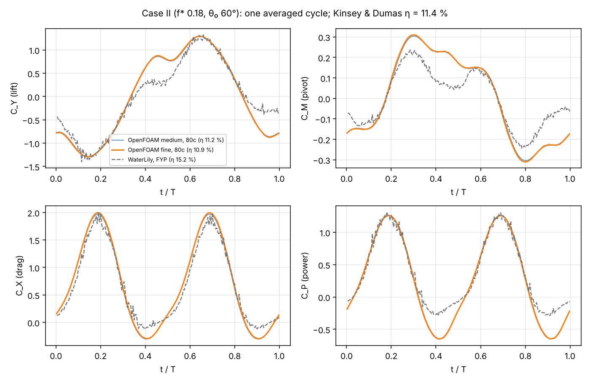

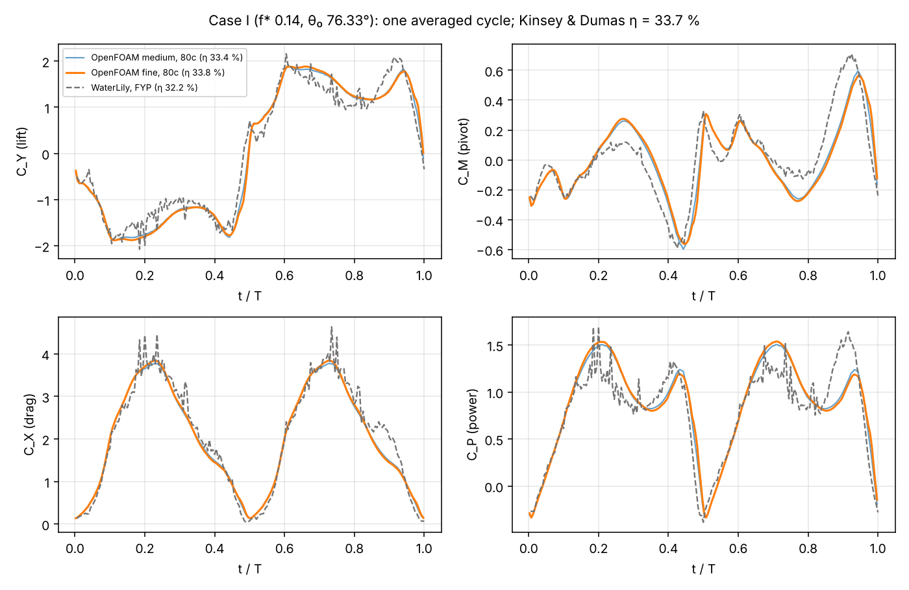

Full tables: [`docs/phase5/phase5_summary.md`](docs/phase5/phase5_summary.md); `scripts/compare_cases.py` rebuilds them from the published runs (`ci-results/phase5/`).

## Phase 6: report, animations and residuals

**Report:** [`report/AE471_Project_Report.docx`](report/AE471_Project_Report.docx) (36 pages, SMME lab-report format, chapters as required by the course guidelines: introduction, reference study, problem formulation, numerical method, verification, results and discussion, limitations, conclusions, references, appendices including the AI-use disclosure). [`report/AE471_Project_Report.pdf`](report/AE471_Project_Report.pdf) is a LibreOffice preview; for the submitted PDF, open the .docx in Word, click **Yes** to update the fields (contents and lists), then *Save as PDF*. The report is generated by [`scripts/report/build_lab.js`](scripts/report/build_lab.js) (docx-js) from the published runs; `fill_toc.py` fills the contents and lists, `eqs.py` draws the equations, `fig_residuals.py` the residual history and `add_anims.py` the animation figures.

**Animations** ([`docs/animations/`](docs/animations), workflow `animations.yml`): one cycle of vorticity for each case, medium mesh, far field 80c, 100 frames per cycle, with the lift and power of the cycle and a moving marker. The vorticity fields of each animated cycle are on `ci-results/anim/<case>/animation/` (`.npz`).

| Case I (f* 0.14, θ₀ 76.33°, η 33.7 %) | Case II (f* 0.18, θ₀ 60°, η 11.4 %) | Case III (f* 0.06, θ₀ 60°, η 12.3 %) |
|---|---|---|
| 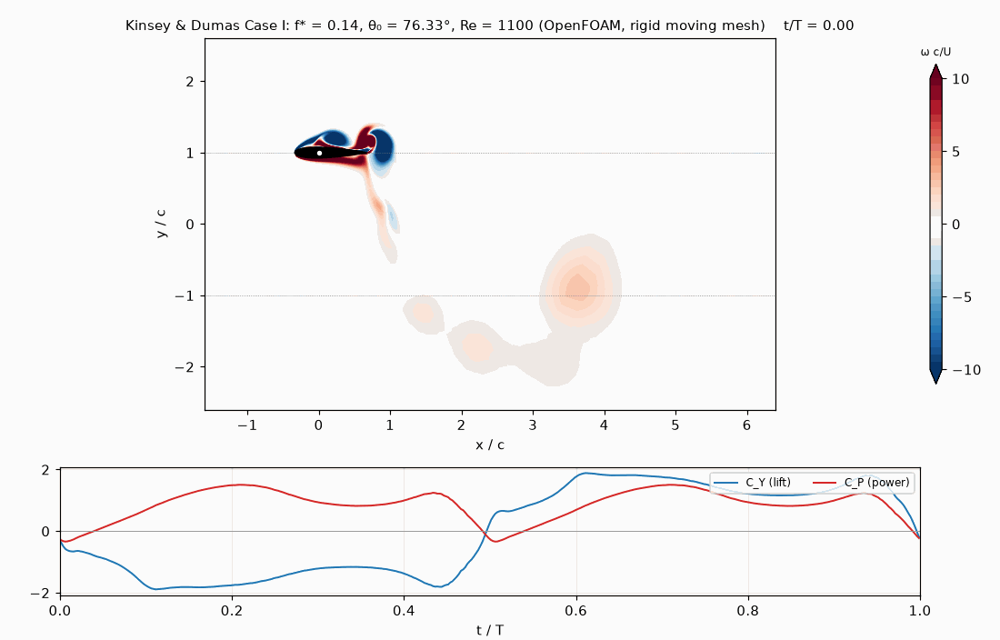 | 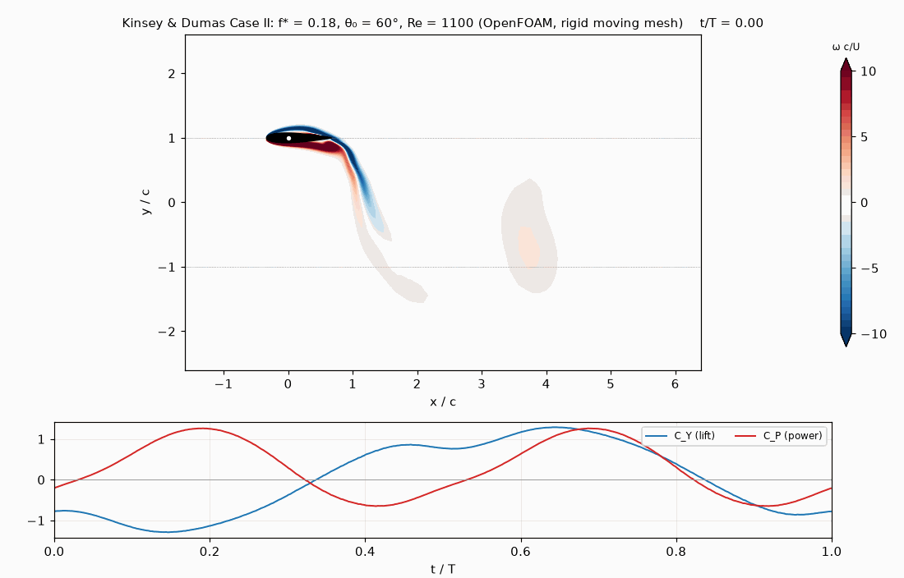 | 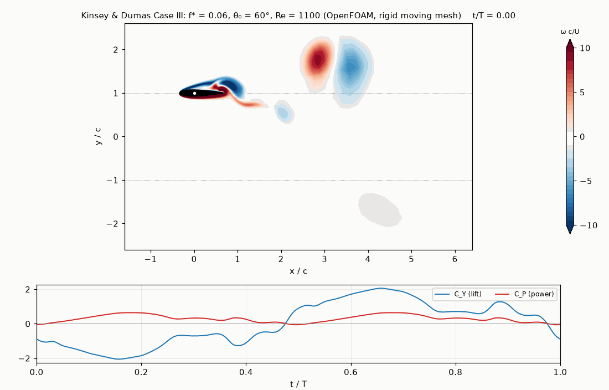 |
| leading-edge vortex forms each stroke and leaves the trailing edge at stroke reversal | flow stays attached, weak narrow wake | leading-edge vortex separates by mid-stroke, strong vortex pairs shed |

**Summary video** (1920×1080, 29 s, all three cases and the efficiency comparison): [`docs/animations/kinsey_dumas_oscillating_foil.mp4`](docs/animations/kinsey_dumas_oscillating_foil.mp4), made by `scripts/report/make_post_video.py` from the saved vorticity fields.

**Residuals** (final Case I fine run, 28,000 steps): the last pressure solve of every step reaches the 10⁻⁸ tolerance, the second PIMPLE outer loop starts ~180 times lower than the first, continuity errors < 10⁻¹⁴, and the pattern repeats every half-cycle after about 8 cycles.

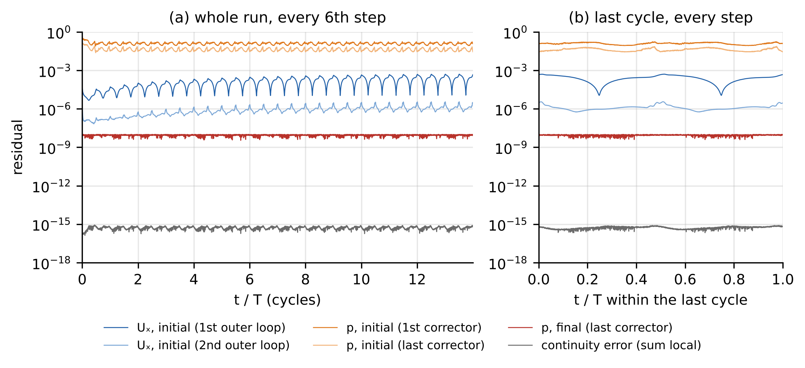

**Animation runs:** `make_animation.py` masks only the cells inside the real foil profile and plots the bin-averaged force trace (first version: thicker mask band left white slivers at the trailing edge).

## Where the results are

Each workflow commits its logs, tables and pictures to the **`ci-results`** branch (`phase0/`, `phase1/<level>/`, `phase2/`, `phase2b/`, `phase34/<run>/`, `phase5/<run>/`), so they can be read without opening the Actions page. Phase 3–4 workflows: `phase3-4.yml`, `phase4b`–`phase4e.yml`; the short trouble-shooting runs: `numerics-tests.yml`, `diagnose.yml`. `scripts/compare_runs.py` rebuilds every Phase 3–4 table and figure from the published runs. Run locally (Linux with OpenFOAM v2412 and `pip install gmsh`):

```
# rigid moving mesh (used for the results)
bash scripts/build_rigid.sh medium run/rigid out/rigid 80     # last argument: far-field radius in chords
LAPL="limited corrected 0.33" bash scripts/setup_rigid.sh run/rigid 10 2000   # KD_CASE=II or III for the other cases
bash scripts/run_solver.sh run/rigid out/rigid 300 && bash scripts/finish_run.sh run/rigid out/rigid
# overset mesh (Phases 0-1)
bash scripts/build_mesh.sh medium run/medium out/medium
bash scripts/motion_test.sh run/medium/main out/medium 200
```
